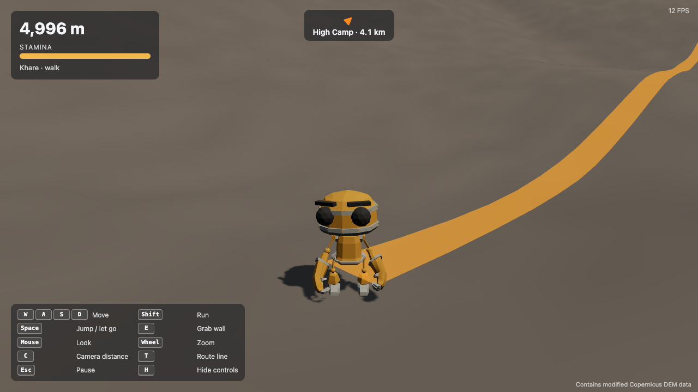

# Mountain Odyssey

A free, browser-based, third-person mountaineering game. Climb terrain built from real elevation data, manage your stamina, read the slope, and earn the summit.

**▶ Play now: https://faisalahmedbijoy.github.io/mountain-odyssey/**



> **Status: playable vertical slice (M1).** You can walk, run, slide and climb on Mera Peak (Nepal) from Khare (≈ 5,000 m) to High Camp (≈ 5,800 m). Weather, oxygen, equipment and the full summit route come in M2 (see [Roadmap](#roadmap)).

## Features

- **Real mountain.** Terrain is generated from the Copernicus GLO-30 elevation model at 2 m resolution and streamed in chunks with level of detail.
- **Climbing that feels physical.** You can walk, run, jump and slide. You can grab any steep rock face (≥ 50°) and climb it in four directions, then mantle over the top. Movement uses a Rapier character controller.
- **Stamina and falls.** Running and climbing drain stamina, and if it runs out on a wall, you fall. A drop of 6–15 m injures you. A drop over 15 m sends you back to the last camp.
- **Route guide.** An orange ribbon on the ground and trail flags mark the walkable route to the next camp, and a HUD arrow shows the distance. The route is computed when the terrain is baked, and it is guaranteed to stay walkable.
- **Survival.** Oxygen, warmth and supplies that interact with stamina; rest at camps to acclimatize.
- **Checkpoints.** Reaching a camp saves your progress, and after a fatal fall you respawn there.
- **Runs in the browser.** It needs a desktop browser with WebGL2 and nothing to install.

## Controls

| Key             | Action                                                               |
| --------------- | -------------------------------------------------------------------- |
| `W` `A` `S` `D` | Move (relative to the camera); while climbing: up, left, down, right |
| `Shift`         | Run (on slopes under 20°)                                            |
| `Space`         | Jump; while climbing, let go                                         |
| `E`             | Grab a steep rock face                                               |
| `F`             | Eat / drink                                                          |
| `O`             | Bottled oxygen (10 min per bottle)                                   |
| `R`             | Rest at a camp                                                       |
| Mouse / wheel   | Look around / zoom                                                   |
| `C`             | Cycle camera distance                                                |
| `T`             | Show or hide the route line                                          |
| `H`             | Show or hide the controls panel                                      |
| `Esc`           | Pause (click the game to resume)                                     |

**Tips**

- Walk to recover stamina before a long climb. One full bar is enough for about 10 m of climbing.
- Ground steeper than 33° makes you slide.
- If you leave the route, follow the HUD arrow back to it.

## Mountains

| Mountain         | URL                                                                                               | Notes                                                                     |
| ---------------- | ------------------------------------------------------------------------------------------------- | ------------------------------------------------------------------------- |
| Mera Peak, Nepal | [`/`](https://faisalahmedbijoy.github.io/mountain-odyssey/)                                       | Real DEM terrain. The route from Khare to High Camp is about 4.1 km.      |
| Test Peak        | [`/?mountain=test-peak`](https://faisalahmedbijoy.github.io/mountain-odyssey/?mountain=test-peak) | A small synthetic mountain with an 8 m cliff ring, for practice and tests |

## Tech stack

| Area               | Technology                                                       |
| ------------------ | ---------------------------------------------------------------- |
| Rendering          | [Three.js](https://threejs.org/) (WebGL2)                        |
| Physics            | [Rapier](https://rapier.rs/) (`@dimforge/rapier3d-compat`, WASM) |
| UI                 | React 19 + Zustand (menus and HUD only)                          |
| Build and language | Vite, TypeScript (strict)                                        |
| Terrain pipeline   | Python 3 (numpy, Pillow, rasterio)                               |
| Tests              | Vitest, pytest, Playwright                                       |
| Hosting            | GitHub Pages, deployed by GitHub Actions                         |

## Getting started

**Requirements**

- Node.js 22 or newer
- Python 3.9 or newer
- A desktop browser with WebGL2

```bash
git clone https://github.com/FaisalAhmedBijoy/mountain-odyssey.git
cd mountain-odyssey
npm install

# Python tools for baking terrain
python3 -m venv .venv
.venv/bin/pip install -r tools/terrain/requirements.txt
source .venv/bin/activate

# Bake the terrain. The output goes to public/terrain/ and is not committed.
npm run terrain:test   # small synthetic mountain, a few seconds
npm run terrain:mera   # Mera Peak: downloads about 25 MB of Copernicus DEM data

npm run dev            # http://localhost:5173 (add ?mountain=test-peak for the test mountain)
```

### Commands

| Command                                       | What it does                                                   |
| --------------------------------------------- | -------------------------------------------------------------- |
| `npm run dev`                                 | Start the Vite dev server                                      |
| `npm run build`                               | Type-check and build the production bundle into `dist/`        |
| `npm test`                                    | Run the unit and integration tests (Vitest)                    |
| `npx vitest run <file>`                       | Run a single test file                                         |
| `npm run e2e`                                 | Run the Playwright smoke tests (bakes the test mountain first) |
| `npm run lint` / `npm run typecheck`          | Run ESLint / TypeScript checks                                 |
| `npm run format`                              | Format with Prettier (CI runs `format:check`)                  |
| `.venv/bin/python -m pytest tools/terrain -q` | Run the terrain pipeline tests                                 |

## How it works

```
Copernicus DEM ──► tools/terrain/bake.py ──► public/terrain/<id>/
                    • resample to 2 m             manifest.json (camps, routes)
                    • place camps on walkable     tiles/<tx>_<tz>.u16
                      ground                      backdrop.u16
                    • A* walkable route
                                                        │
                                                        ▼
React (menus, HUD) ◄── Zustand store ◄── Game engine (pure TypeScript)
                       (≤ every 100 ms)    ├─ ChunkManager: streams tiles, LOD, colliders
                                           ├─ Player: Rapier character controller
                                           ├─ RouteGuide: ribbon, flags, HUD arrow
                                           ├─ Three.js renders · Rapier simulates
                                           └─ fixed 60 Hz simulation loop
```

- **Terrain is data, not code.** Adding a mountain takes a bake config and a small JSON file, with no engine changes.
- **The engine never imports React.** React only starts and stops the game, and it reads HUD state from a store.
- **Gameplay numbers are tunable.** Every gameplay number (speeds, slope limits, stamina rates, fall heights, camera, LOD) lives in [`src/engine/config/game.config.ts`](src/engine/config/game.config.ts).

### Project layout

```
src/engine/      game engine: core loop, world/terrain, physics, player, camera, systems
src/app/         React shell (game view, WebGL and device checks)
src/ui/          HUD components
src/data/        mountain definitions
tools/terrain/   offline terrain bake (Python)
e2e/             Playwright smoke tests
docs/            design spec, implementation plans, playtest checklist
```

## Deployment

Every push to `main` runs CI: formatting, lint, type check, unit tests, terrain tests, build and E2E. When CI passes, the [Deploy to GitHub Pages](.github/workflows/deploy.yml) workflow:

1. Bakes the terrain.
2. Builds with `VITE_BASE=/mountain-odyssey/`.
3. Publishes `dist/`.

To check the production build locally:

```bash
VITE_BASE=/mountain-odyssey/ npm run build
npx vite preview --base /mountain-odyssey/
```

Files in `public/` must be referenced through `assetUrl()` ([`src/app/assetUrl.ts`](src/app/assetUrl.ts)) so they resolve under the base path.

## Roadmap

| Milestone              | Scope                                                                                                                                                              | State                         |
| ---------------------- | ------------------------------------------------------------------------------------------------------------------------------------------------------------------ | ----------------------------- |
| **M1: Vertical slice** | Terrain streaming, character, camera, walk/run/slide/climb, stamina, fall damage, checkpoints, route guide                                                         | ✅ Done; playtest in progress |
| **M2: Public v1.0**    | Full Mera Peak route to the summit, oxygen, body temperature and supplies, weather, equipment and pack weight, expedition prep and menus, save and settings, audio | Planned                       |
| **M3: More mountains** | More peaks through the same pipeline, 3D globe explorer, achievements                                                                                              | Planned                       |
| **Phase 2: Online**    | Accounts, cloud save, leaderboards                                                                                                                                 | Later                         |

The full design is in [`docs/superpowers/specs/2026-11-03-mountain-odyssey-design.md`](docs/superpowers/specs/2026-11-03-mountain-odyssey-design.md).

## Playtesting

Played it? The checklist in [`docs/playtest/m1-checklist.md`](docs/playtest/m1-checklist.md) covers performance, movement, climbing, camera and whether it's fun. Feedback and issues are welcome.

## Credits

- **Terrain:** Contains modified Copernicus DEM data (Copernicus GLO-30, © DLR e.V. / ESA, provided under the Copernicus licence).
- **Character:** "RobotExpressive" by Tomás Laulhé, with modifications by Don McCurdy (CC0 1.0). This is a placeholder for M1.

See [`CREDITS.md`](CREDITS.md) for the full list.

> Routes are game-designed and inspired by real mountains. This game is not a guide for real-world climbing.

## License

The source code is released under the [MIT License](LICENSE). Third-party assets and data (see [CREDITS.md](CREDITS.md)) keep their own licences, including the Copernicus DEM terms.
